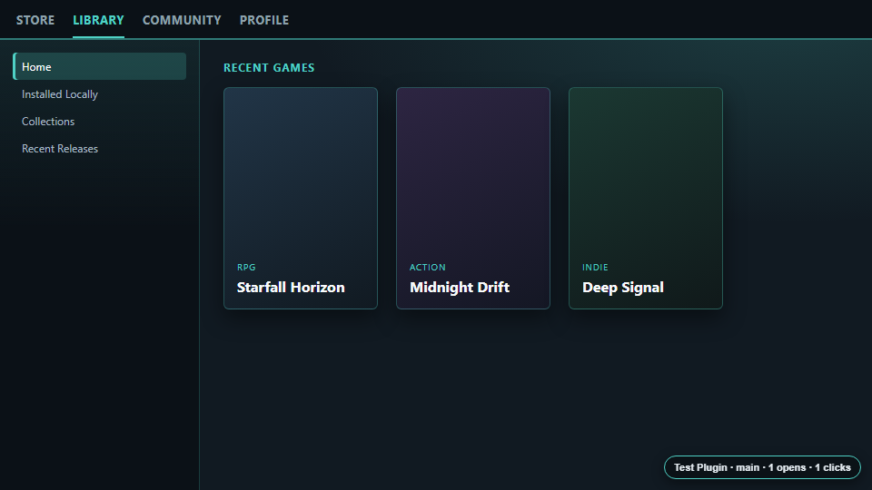

<h1 align="center">Test Plugin</h1>

A small reference plugin for LYTE showing desktop popups, DOM mounting, live CSS updates, user options, per-plugin storage and notifications.

## Files

| File | Purpose |
| --- | --- |
| `lyte.catalog.json` | Catalog name, version, description, license and preview image |
| `lyte.plugin.json` | Entry script, stylesheet, requested permissions and user options |
| `plugin.js` | Activation hook, popup pill mounting, persistent click counter and cleanup |
| `plugin.css` | Stylesheet using plugin option variables and root attributes |

## Permissions

| Permission | Why it is requested |
| --- | --- |
| `dom` | Mounts and removes the clickable pill button inside desktop windows |
| `popups` | Reacts when Steam desktop windows open and tears down cleanly |
| `styles` | Adds a dynamic desktop transition rule alongside `plugin.css` |
| `storage` | Remembers total window open counts and pill click counts across sessions |
| `notifications` | Sends an optional notice on startup or pill clicks when **Startup notice** is enabled |

## Options

| Option | Type | Default | What it does |
| --- | --- | --- | --- |
| Badge accent | Color | `#4fd1c5` | Border color of the floating status pill |
| Badge size | Slider | `11px` | Font size from 9 px to 16 px |
| Corner | Select | `Bottom right` | Places the pill in bottom-right, bottom-left or top-right |
| Show status pill | Toggle | `true` | Shows or hides the pill cleanly without disabling storage |
| Startup notice | Toggle | `false` | Posts a notice when loaded or when clicking the pill |

## Install

Install from the LYTE catalog, or clone this repository locally to test enabling, live option changes and full teardown on disable.

## License

MIT
